# Grupo Sampaio — Sites, e-commerce e gestão empresarial

Desenvolvi uma solução que reúne **os sites das lojas, o e-commerce, o sistema de gestão e os PDVs** do Grupo Sampaio. Integrei a apresentação dos produtos e a área de compras do cliente às rotinas de cadastro, estoque e gestão de cada operação.

## Sites das lojas e e-commerce integrado

Além do sistema de gestão e dos PDVs, desenvolvi **o site do Grupo Sampaio e as vitrines de cada loja**. Reuni essas duas frentes no mesmo projeto: a equipe administra os produtos no ERP e os clientes acessam o catálogo online, criam sua conta e realizam pedidos pela área de compras.

Desenvolvi os sites com **layout responsivo para celular, tablet e computador**, adaptando grades, filtros e formulários à largura disponível. Mantive a identidade visual de cada negócio, com cores e informações próprias dentro de uma estrutura compartilhada.

**Nesta apresentação:** [Portal do grupo](#portal-do-grupo) · [Sites de cada loja](#sites-de-cada-loja) · [Integração com o ERP](#integração-do-catálogo-com-o-erp) · [Conta do cliente e compras](#conta-do-cliente-e-compras) · [Responsividade](#celular-tablet-e-computador) · [Sistema e PDVs](#conheça-o-projeto)

### Portal do grupo

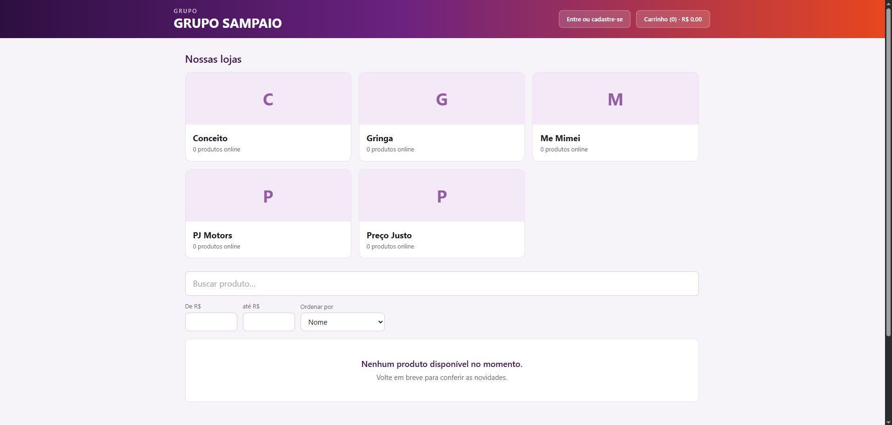

Criei uma página de entrada para apresentar as cinco lojas: **Conceito, Gringa, Me Mimei, PJ Motors e Preço Justo**. Organizei os acessos em cards com o nome de cada negócio e a quantidade de produtos online, permitindo que o cliente escolha a loja que deseja visitar.

No cabeçalho, disponibilizei os acessos **“Entre ou cadastre-se”** e **“Carrinho”**, com quantidade de itens e valor total. Abaixo das lojas, incluí busca de produtos, faixa de preços e ordenação. Com essa estrutura, ofereço tanto uma entrada pelo grupo quanto um caminho para a vitrine específica de cada negócio.

Na captura, as cinco lojas estão sem produtos publicados e a página apresenta a mensagem de catálogo vazio. Esse é o estado do ambiente no momento do registro; as imagens seguintes também mostram as vitrines nessa condição.

### Sites de cada loja

Utilizei uma base compartilhada para manter a navegação consistente e personalizei a apresentação de cada loja com nome, cores, segmento e identificação no rodapé. Em todas as vitrines abaixo, deixei acessíveis a conta do cliente, o carrinho, a busca e os filtros.

#### Conceito — moda e vestuário

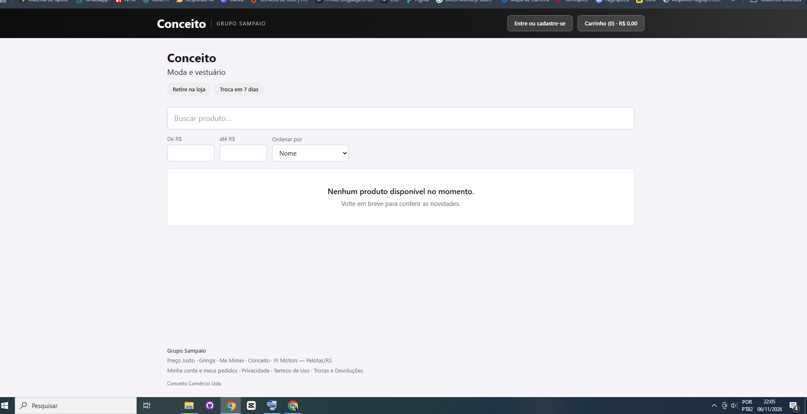

Para a Conceito, utilizei um cabeçalho escuro e destaquei o segmento **“Moda e vestuário”**. Abaixo da apresentação, organizei a busca, os limites mínimo e máximo de preço e a ordenação dos produtos.

Na captura, aparecem os textos “Retire na loja” e “Troca em 7 dias”, além dos links de conta, pedidos e políticas no rodapé. A vitrine está sem itens publicados, por isso o espaço do catálogo informa que não há produtos disponíveis naquele momento.

#### Gringa — moda e vestuário

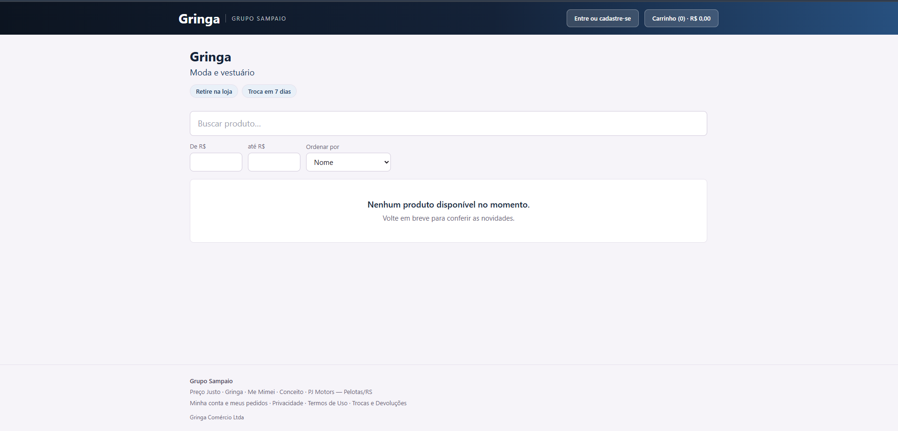

Na Gringa, apliquei a identidade em azul ao cabeçalho e aos elementos de apresentação. Mantive o segmento **“Moda e vestuário”** e a mesma organização de busca e filtros utilizada na estrutura das lojas.

No rodapé, identifiquei a empresa e reuni os caminhos para a conta do cliente, os pedidos e as políticas. Assim, preservei a identidade da Gringa sem alterar o padrão de navegação que o cliente encontra nas demais vitrines.

#### Me Mimei — beleza e maquiagem

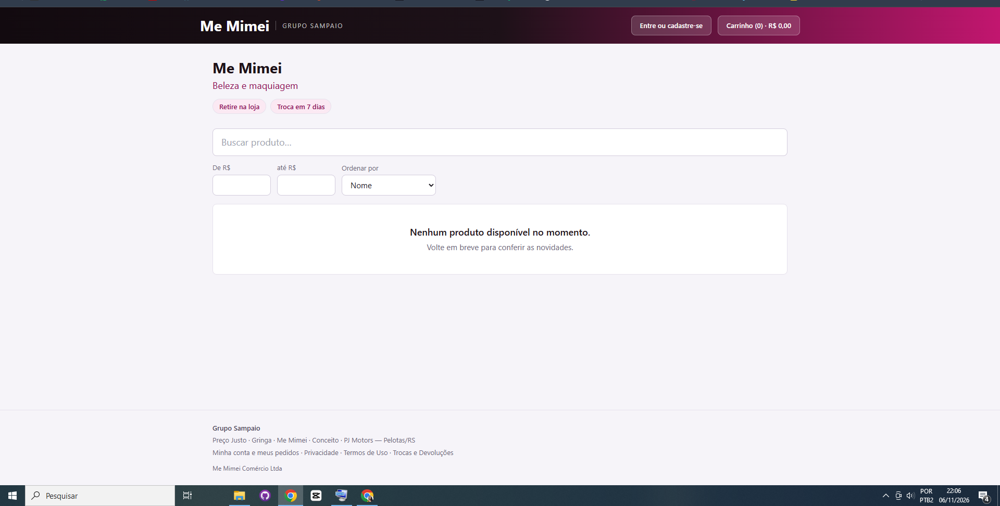

Para a Me Mimei, utilizei tons de rosa no cabeçalho, no segmento **“Beleza e maquiagem”** e nos destaques da interface. Mantive o catálogo, a conta do cliente e o carrinho dentro do mesmo fluxo das outras lojas.

A captura mostra como adaptei a identidade para um negócio de outro segmento sem precisar criar uma aplicação independente. Os filtros de preço e a ordenação permanecem disponíveis mesmo no estado de catálogo vazio.

#### PJ Motors — motos elétricas e acessórios

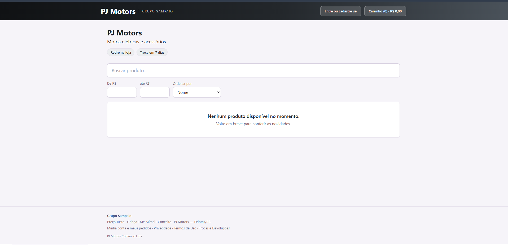

Na PJ Motors, apresentei o segmento **“Motos elétricas e acessórios”** com uma identidade em tons escuros e cinza. Organizei a página para que o cliente possa pesquisar os produtos disponibilizados pela operação e avançar pelo carrinho.

Este site faz parte do e-commerce integrado ao ERP Grupo Sampaio. Ele é uma frente diferente da landing page comercial da PJ Motors, que será apresentada em seu próprio projeto.

#### Preço Justo — importadora de variedades

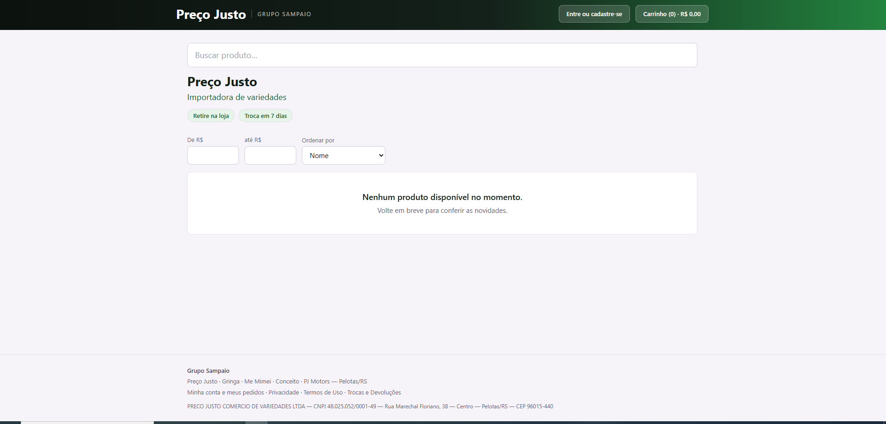

Na Preço Justo, apliquei a identidade verde e destaquei o segmento **“Importadora de variedades”**. Nesta composição, posicionei a busca antes da apresentação da loja, mantendo os filtros de preço e a ordenação logo abaixo.

No rodapé, incluí a identificação da empresa, os dados comerciais exibidos pela aplicação e os links de conta, pedidos e políticas. A captura conecta a marca que já apresentei no PDV à sua frente de atendimento online.

### Integração do catálogo com o ERP

Integrei a vitrine ao cadastro de produtos e ao saldo de estoque das operações. **Não mantive um catálogo ou estoque paralelo para o e-commerce.** Os produtos gerenciados no sistema são a origem das informações apresentadas nas lojas online.

A publicação possui um controle próprio: **cadastrar um produto não o torna automaticamente público**. O serviço da vitrine consulta os itens ativos e habilitados para publicação online, respeitando as regras de visibilidade. Peças de bancada não entram nessa seleção de mercadorias.

| Etapa | Como organizei a integração |
| --- | --- |
| Cadastro | Centralizei no ERP os produtos de cada operação. |
| Publicação | Utilizei o controle de publicação online para selecionar os itens da vitrine. |
| Catálogo | Reutilizei os dados comerciais e o saldo da operação na apresentação dos produtos. |
| Carrinho e pedido | Conectei a seleção do cliente ao fluxo de checkout, com recorte por operação. |
| Estoque | No serviço de loja, implementei reserva pelo pedido e baixa após confirmação do pagamento; o cancelamento libera a reserva. |
| Gestão | Mantive o atendimento de balcão e os pedidos online no mesmo projeto, com critérios próprios de acompanhamento. |

Implementei essas regras no [serviço da loja online](server/src/services/core/StorefrontService.ts). A [página da loja](src/pages/gs/LojaPage.tsx) reúne a navegação do catálogo e o checkout.

### Conta do cliente e compras

Criei uma área de conta para conectar a compra à identificação do cliente. Além de disponibilizar “Entre ou cadastre-se” no cabeçalho, incluí no projeto recursos para gerenciar os dados da conta, salvar endereços e consultar os pedidos.

| Recurso | Finalidade |
| --- | --- |
| Cadastro e login | Permitir que o cliente se identifique na área de compras. |
| Carrinho | Reunir os produtos escolhidos antes do fechamento do pedido. |
| Endereços salvos | Reutilizar os dados de entrega e facilitar compras posteriores. |
| Checkout | Associar o pedido à conta e ao endereço selecionado, conforme a modalidade disponível. |
| Minha conta e meus pedidos | Oferecer acesso às informações da conta e ao acompanhamento das compras. |

Para compras com entrega, previ a seleção ou o cadastro de um endereço completo. As opções de entrega ou retirada e os serviços de pagamento dependem da configuração de cada operação e das integrações disponíveis.

O gerenciamento de endereços está no componente [Conta do cliente](src/components/gs/ContaDoCliente.tsx), e o uso desses dados na compra está em [Checkout da conta](src/components/gs/CheckoutDaConta.tsx).

### Celular, tablet e computador

**Desenvolvi o site para se redimensionar conforme o dispositivo utilizado.** Utilizei grades responsivas, campos que aproveitam a largura disponível e mudanças de disposição para manter os controles acessíveis em diferentes tamanhos de tela.

| Dispositivo | Adaptação prevista no layout |
| --- | --- |
| Celular | Grade em uma coluna, acesso compacto aos filtros e campos e botões adequados à largura da tela. |
| Tablet | Reorganização dos cards em colunas e ajuste dos controles ao espaço intermediário. |
| Computador | Distribuição mais ampla dos cards, filtros e formulários, aproveitando a largura disponível. |

No código, defini a grade das lojas com uma coluna na base, duas a partir de `sm` e três a partir de `lg`. Também adaptei a abertura dos filtros em telas menores e a distribuição dos campos de checkout. Os limites de layout consideram a largura da tela, não apenas o nome do dispositivo.

As seis imagens desta seção foram capturadas no computador. Elas apresentam as páginas e suas identidades; a adaptação para outras larguras está implementada no layout responsivo e poderá ser ilustrada com capturas de celular e tablet.

---

## Conheça o projeto

Na frente administrativa, reuni a operação de balcão e o acompanhamento de diferentes negócios em uma aplicação. Meu objetivo é conectar o trabalho de quem vende, atende e recebe pagamentos às informações utilizadas pela gestão, mantendo o contexto da operação em cada tela.

A interface utiliza **React, TypeScript, Vite e Tailwind CSS**. O backend utiliza **Node.js, Express e SQLite**. A documentação técnica, as instruções de instalação e as condições das integrações estão disponíveis após esta apresentação.

**Explore:** [Painel de gestão](#painel-de-gestão) · [Operações e módulos](#operações-e-módulos) · [PDVs das lojas](#pdvs-das-lojas) · [PDV da oficina](#pdv-da-oficina) · [Simulação de venda](#simulação-de-venda) · [Como interpretar as capturas](#como-interpretar-as-capturas) · [Documentação técnica e instalação](#documentação-técnica-e-instalação)

> Registrei as imagens abaixo em uma sessão de demonstração, incluindo a simulação de uma venda. Os valores representam a base e o período exibidos nas telas; não constituem divulgação de resultados comerciais. As capturas mostram estados específicos da aplicação, não substituem testes de funcionamento ou homologação de serviços externos.

### Painel de gestão

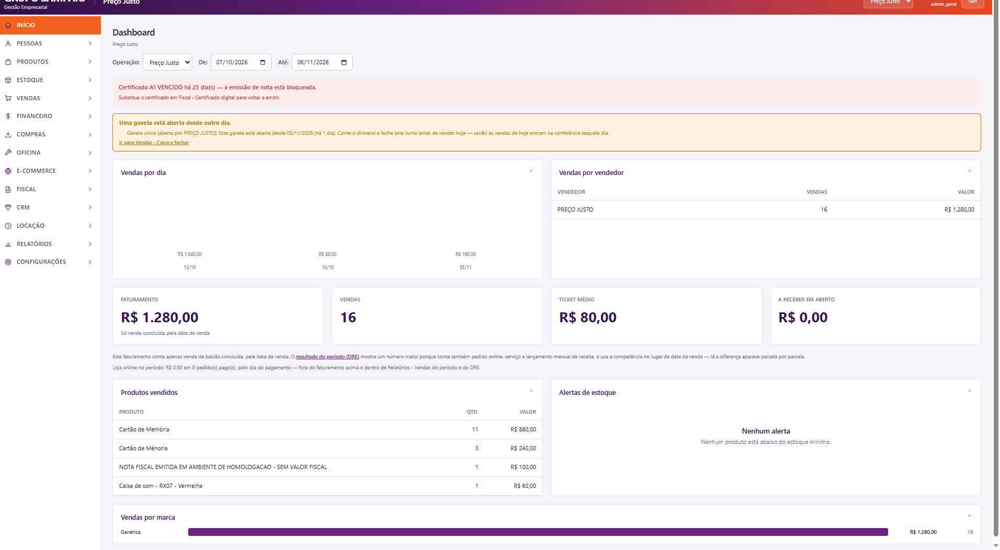

O painel apresenta uma visão administrativa da **Preço Justo**, com filtros de operação e período. Na captura, o recorte vai de **07/10/2026 a 06/11/2026**. O gestor pode acompanhar o movimento do período por meio de indicadores e detalhamentos na mesma página.

| Informação visível | Leitura da captura | Utilidade para a gestão |
| --- | --- | --- |
| Faturamento | R$ 1.280,00 | Acompanhar o total de vendas de balcão concluídas, conforme o critério informado na própria tela. |
| Vendas | 16 | Identificar o volume de vendas no período selecionado. |
| Ticket médio | R$ 80,00 | Relacionar faturamento e quantidade de vendas: R$ 1.280,00 ÷ 16. |
| A receber em aberto | R$ 0,00 | Consultar o valor apresentado como pendente, sem confundir esse indicador com o faturamento. |
| Vendas por dia | Valores distribuídos por datas | Observar a distribuição temporal das vendas. |
| Vendas por vendedor | Quantidade e valor atribuídos ao vendedor | Acompanhar a participação do vendedor no resultado exibido. |
| Produtos vendidos | Produto, quantidade e valor | Identificar quais itens compõem as vendas do período. |
| Alertas de estoque | Nenhum alerta na captura | Consultar a sinalização de produtos abaixo do estoque mínimo. |

A página também explica que o faturamento de balcão e o resultado do período no DRE possuem critérios diferentes. Isso ajuda o usuário a interpretar os números antes de comparar relatórios. O texto visível separa ainda os pedidos pagos da loja online, que aparecem zerados nesta captura.

No topo, dois avisos chamam atenção para ações operacionais: **certificado A1 vencido**, com emissão de nota bloqueada, e **gaveta aberta desde outro dia**, com orientação para conferir e fechar o turno anterior. A presença dos avisos faz parte do estado demonstrado; a imagem não comprova emissão fiscal ativa.

**Relação com a venda simulada:** este painel contextualiza onde as informações gerenciais são consultadas. Como não há uma captura posterior identificando a venda de R$ 80,00, os 16 registros e os R$ 1.280,00 não são atribuídos especificamente à simulação apresentada mais adiante.

### Operações e módulos

#### Seleção da operação ativa

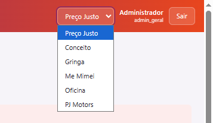

O seletor da barra superior reúne **Preço Justo, Conceito, Gringa, Me Mimei, Oficina e PJ Motors**. A operação ativa fica identificada ao lado da área do administrador, permitindo reconhecer o contexto de trabalho.

Esse controle representa a navegação entre operações da estrutura multiempresa. A separação de acesso e dados depende da sessão e das verificações no servidor; o seletor visual, sozinho, não constitui uma prova de isolamento entre empresas. A arquitetura desse controle está descrita em [Arquitetura do núcleo](docs/ARQUITETURA-NUCLEO.md).

#### Navegação administrativa

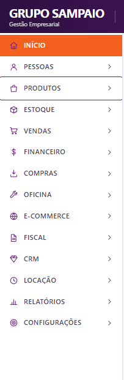

O menu organiza o acesso por áreas de trabalho:

| Área | Papel na organização da interface |
| --- | --- |
| Início | Entrada para o painel de acompanhamento. |
| Pessoas | Acesso à gestão de pessoas e cadastros relacionados. |
| Produtos e Estoque | Acesso aos cadastros de mercadorias e controles de estoque. |
| Vendas e Financeiro | Acesso às rotinas comerciais e financeiras. |
| Compras | Acesso às rotinas de aquisição. |
| Oficina | Acesso ao atendimento e às rotinas de manutenção. |
| E-commerce e Fiscal | Acesso aos módulos de comércio eletrônico e rotinas fiscais. |
| CRM e Locação | Acesso às áreas de relacionamento e locação. |
| Relatórios e Configurações | Consulta de informações e administração do sistema. |

A captura evidencia a organização da navegação. O estado de implementação de cada módulo e as dependências de serviços externos devem ser consultados em [Estado atual](docs/ESTADO-ATUAL.md), sem presumir que a presença de um item de menu significa homologação completa.

### PDVs das lojas

#### Preço Justo — estrutura de atendimento no balcão

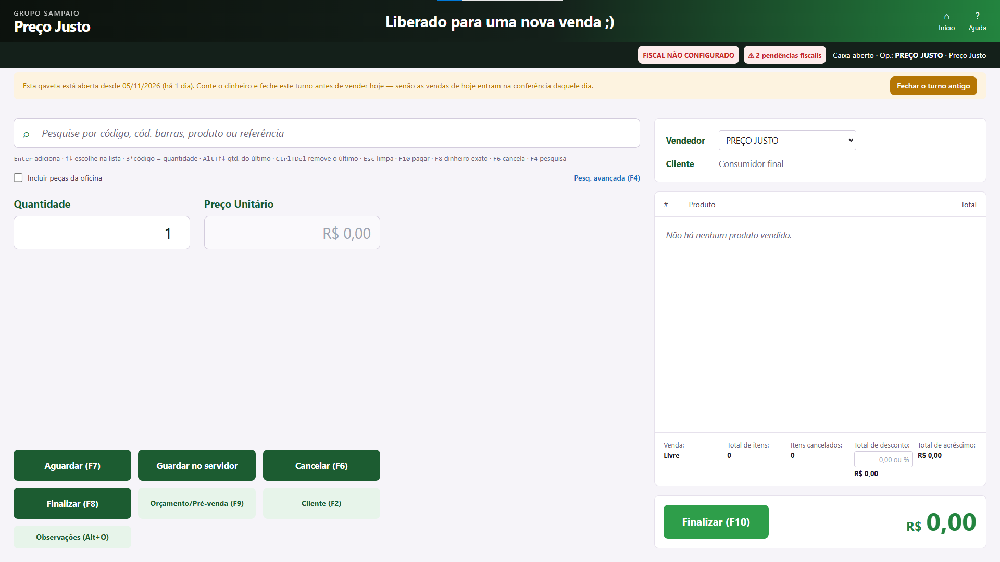

O PDV concentra as ações utilizadas no atendimento: pesquisa por **código, código de barras, produto ou referência**, quantidade, preço unitário, identificação do vendedor e cliente, lista de itens e total da venda.

A organização coloca a entrada de produtos à esquerda e o resumo do carrinho à direita. Na parte inferior ficam as ações de aguardar, guardar no servidor, cancelar, finalizar, preparar orçamento/pré-venda, selecionar cliente e registrar observações. Os atalhos de teclado aparecem junto aos comandos e na orientação abaixo da busca.

Nesta captura, o carrinho está vazio e o total é **R$ 0,00**. O caixa está identificado como aberto, mas há um aviso de turno anterior ainda pendente de fechamento. O cabeçalho também informa pendências fiscais. A mensagem central de disponibilidade para nova venda deve ser lida em conjunto com esses avisos.

#### Mesma estrutura de PDV, identidade de cada negócio

As telas abaixo mostram a continuidade do fluxo de atendimento entre as lojas. Nome da operação, identificação do vendedor, cores e ações principais permitem reconhecer o negócio em que o usuário está trabalhando.

**Me Mimei**

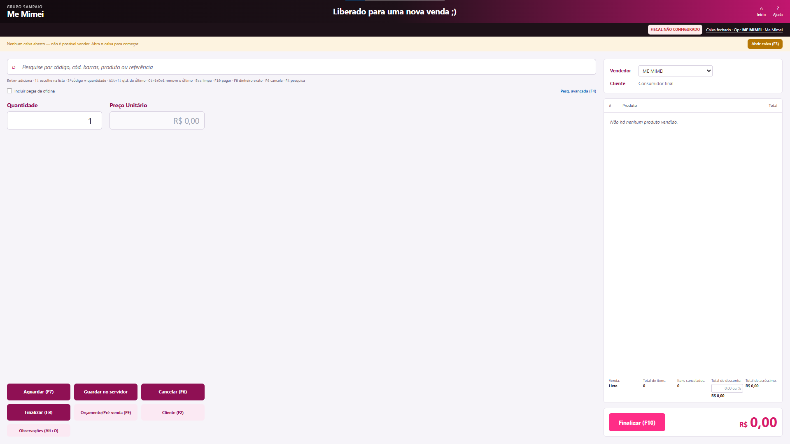

A operação Me Mimei utiliza identidade em rosa e mantém a busca, os campos de quantidade e preço e o carrinho no mesmo arranjo do PDV. O vendedor está identificado como **ME MIMEI**. O aviso superior informa que **não há caixa aberto** e oferece a ação “Abrir caixa (F3)”, indicando o passo necessário antes de iniciar vendas. A captura também apresenta o estado fiscal não configurado.

**Gringa**

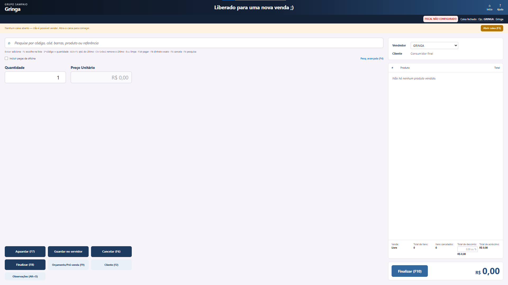

Na Gringa, o cabeçalho e os botões adotam tons de azul, preservando o padrão de atendimento. A identificação **GRINGA** aparece no contexto da operação e no campo de vendedor. Carrinho vazio, total zerado e aviso de caixa fechado mostram o estado anterior ao início de uma venda, com a ação de abertura de caixa disponível no topo.

**Conceito**

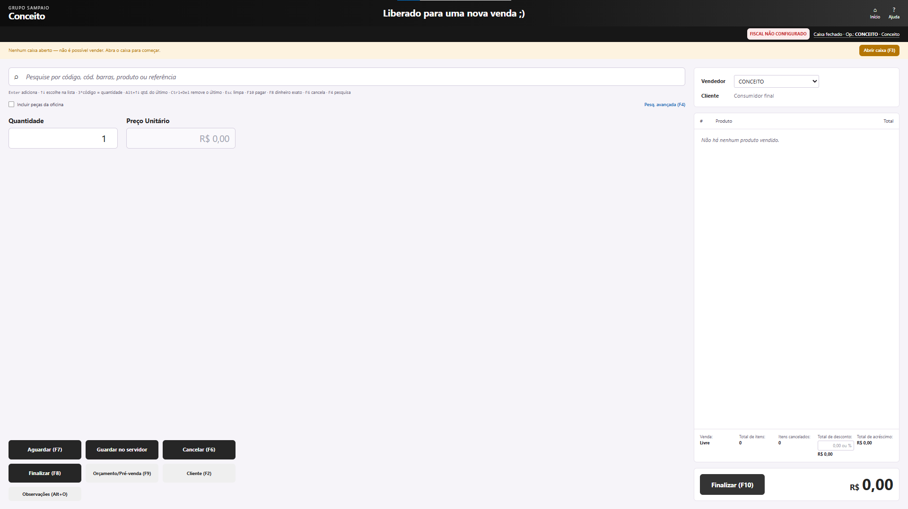

A Conceito utiliza uma composição escura nos elementos de identificação e ação. A tela mantém busca por produto, seleção de cliente, orçamento/pré-venda e totalização em posições consistentes com os demais PDVs. O vendedor está identificado como **CONCEITO**, e a faixa de caixa fechado orienta o operador a abrir o caixa para começar.

**PJ Motors**

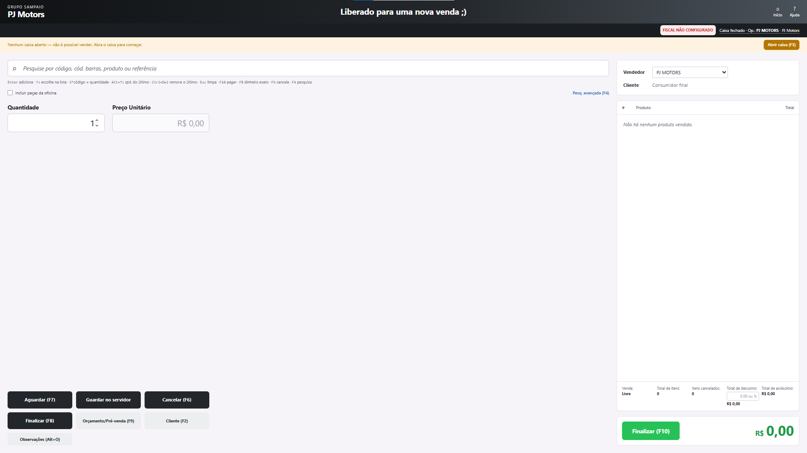

Na PJ Motors, o nome da operação e o vendedor **PJ MOTORS** identificam o contexto de venda. O botão de finalização e o total aparecem em verde. A captura mostra o PDV sem itens e com caixa fechado; ela apresenta a interface de balcão desta operação, não uma venda de veículo concluída.

Essa consistência visual reduz a necessidade de reaprender a posição dos comandos ao trabalhar em diferentes operações. As capturas demonstram a adaptação de identidade e contexto, sem afirmar que as cinco lojas compartilharam caixa ou realizaram vendas nessa sessão.

### PDV da oficina

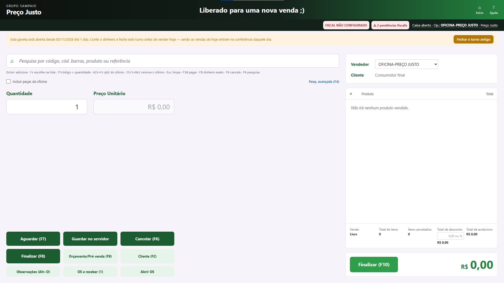

Esta tela mostra o atendimento da **oficina da Preço Justo**, identificado pelo operador/vendedor **OFICINA-PREÇO JUSTO**. O cabeçalho continua associado à Preço Justo: o perfil de atendimento da oficina não deve ser confundido com uma nova empresa apenas por possuir identificação própria.

Além dos comandos de balcão, a tela apresenta:

- **Incluir peças da oficina:** opção visível junto à busca para o contexto de peças de manutenção.
- **OS a receber (1):** acesso à fila de recebimento, com um registro sinalizado no momento da captura.
- **Abrir OS:** entrada para a abertura de uma ordem de serviço.

O objetivo desse conjunto é aproximar o atendimento de manutenção do recebimento no caixa. A imagem mostra os pontos de entrada desse fluxo, mas não exibe o conteúdo da OS ou sua liquidação.

O projeto contempla duas oficinas na documentação técnica. **A captura fornecida nesta apresentação representa apenas a oficina da Preço Justo**; não é uma imagem da oficina de motos. O estado de caixa e os avisos fiscais permanecem visíveis para orientar o atendimento.

### Simulação de venda

A sequência fornecida pelo autor exemplifica a preparação de uma venda de **um cartão de memória por R$ 80,00**, na operação Preço Justo, seguida do lançamento do pagamento em dinheiro.

#### Etapa 1 — produto no carrinho

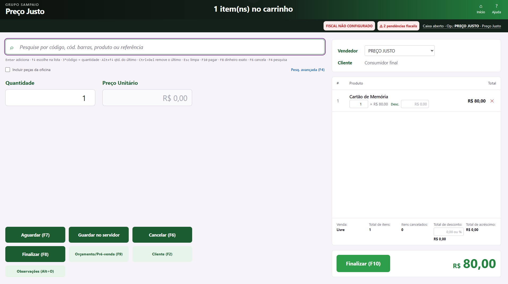

O produto **Cartão de Memória** aparece no carrinho com quantidade **1**, preço unitário de **R$ 80,00** e total de **R$ 80,00**. A linha permite visualizar quantidade e desconto, além do comando de remoção. O resumo inferior mostra um item, nenhum item cancelado e ausência de desconto ou acréscimo.

O vendedor permanece identificado como Preço Justo e o cliente aparece como consumidor final. O total em destaque e a ação “Finalizar (F10)” conduzem ao pagamento. A captura evidencia a composição do carrinho; ainda não é uma confirmação de venda concluída.

#### Etapa 2 — lançamento do pagamento

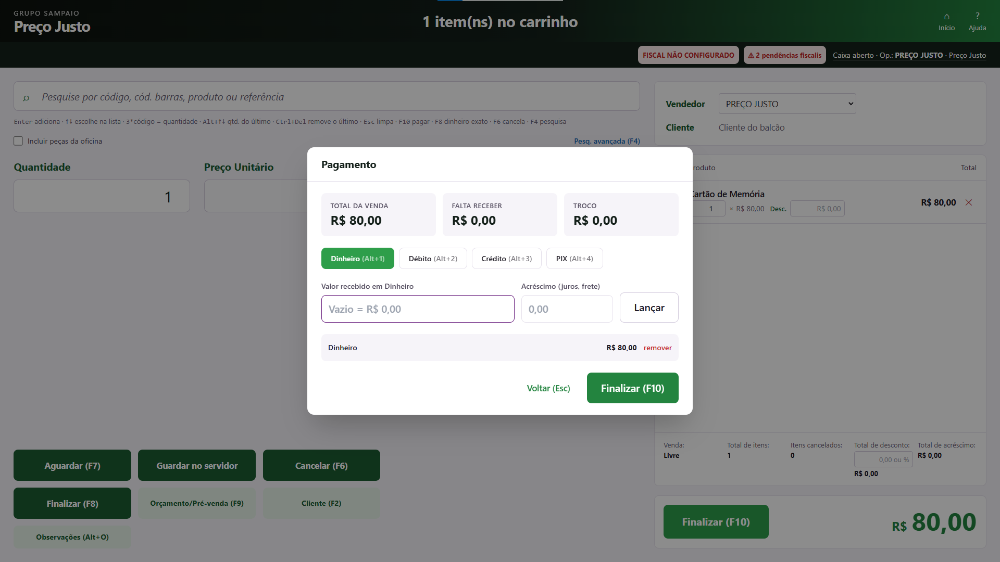

A janela de pagamento apresenta o resumo financeiro e as opções **Dinheiro, Débito, Crédito e PIX**, acompanhadas de atalhos. Na simulação, há um lançamento em **dinheiro de R$ 80,00**.

| Campo | Valor exibido | Significado neste exemplo |
| --- | --- | --- |
| Total da venda | R$ 80,00 | Valor do carrinho levado ao pagamento. |
| Pagamento lançado | Dinheiro — R$ 80,00 | Valor já incluído na lista de recebimentos da janela. |
| Falta receber | R$ 0,00 | O pagamento lançado cobre o total apresentado. |
| Troco | R$ 0,00 | Não há diferença a devolver no exemplo. |

Também estão visíveis o campo de valor recebido, o campo de acréscimo, o botão “Lançar”, a remoção de pagamento e a ação final de confirmação.

**Limite da evidência:** a janela permanece aberta e o botão “Finalizar (F10)” ainda está disponível. Portanto, esta sequência comprova visualmente o carrinho e o pagamento preparado. Não há, nestas imagens, comprovante de conclusão, autorização de cartão, confirmação bancária de PIX, nota fiscal emitida ou painel posterior que individualize essa transação.

O fluxo entre PDV e gestão é implementado pelo backend: o [serviço de vendas](server/src/services/core/SalesService.ts) reúne registro de itens, movimentos de estoque, caixa e financeiro em transação; o [painel administrativo](src/pages/gs/PainelPage.tsx) consulta os dados por operação e período. Essa relação explica a arquitetura do processo, sem transformar a captura do pagamento em prova de execução de todas essas etapas.

### Como interpretar as capturas

- **Caixa fechado:** o sistema informa a condição e oferece a abertura do caixa.
- **Turno anterior aberto:** o aviso orienta a conferência e o fechamento antes de prosseguir com o novo dia.
- **Fiscal não configurado e certificado vencido:** são estados visíveis do ambiente retratado; as imagens não demonstram emissão fiscal habilitada.
- **Opções de débito, crédito e PIX:** mostram os meios apresentados pela interface; não comprovam homologação de terminal ou provedor.
- **Indicadores de gestão:** pertencem ao filtro e à base exibidos, sem vínculo individual demonstrado com a venda simulada.
- **Imagens originais:** as 11 capturas foram incluídas sem alteração dos valores e mensagens da aplicação.

## Documentação técnica e instalação

A seguir estão as instruções técnicas do projeto. Para o estado vigente de cada módulo, consulte sempre [Estado atual](docs/ESTADO-ATUAL.md).

> **Estado honesto do projeto.** O sistema roda: balcão, estoque, caixa,
> vendas, financeiro, compras, oficina, e-commerce, CRM, locação, BI e
> conciliação estão sobre banco central e cobertos por teste. Os módulos que
> dependem de terceiros (NF-e/NFC-e, Asaas, TEF, transportadoras, impressão
> silenciosa, banco central Supabase) têm o código pronto e **não estão
> homologados** — falta credencial ou equipamento, e enquanto faltar a tela diz
> o que falta em vez de oferecer botão que falha.
>
> O quadro completo, módulo a módulo, está em
> [`docs/ESTADO-ATUAL.md`](docs/ESTADO-ATUAL.md) — é ele que responde pelo
> estado do sistema. Nenhum módulo é declarado "pronto para produção" sem
> evidência.

**Versão 1.0.0** — canal `stable`.

## Requisitos

- **Node.js 22+** (o banco usa `node:sqlite`, nativo a partir do Node 22)
- npm 9+
- Windows 10/11, macOS ou Linux

## Instalação

```bash
npm install && npm install --prefix server
```

### Windows: liberar a execução de scripts

No PowerShell, `npm` é um script `.ps1`. Com a política padrão do Windows ele
falha com *"execução de scripts foi desabilitada neste sistema"* — o erro
aparece já no `npm install` e costuma ser confundido com problema de instalação
do Node. Libere uma vez, para o seu usuário:

```powershell
Set-ExecutionPolicy -Scope CurrentUser RemoteSigned
```

`RemoteSigned` permite scripts locais e exige assinatura apenas nos baixados da
internet. Não é necessário no Git Bash, no cmd.exe, no macOS nem no Linux.

Copie o exemplo de ambiente e defina os segredos do backend:

```bash
cp .env.example .env
```

`DEVORA_JWT_SECRET` e `DEVORA_ENCRYPTION_KEY` são obrigatórios. Em produção o
servidor **recusa subir** com os valores padrão de desenvolvimento.

## Banco de dados

O banco central é um arquivo SQLite (`server/data/grupo-sampaio.db` por
padrão, configurável em `DEVORA_DATABASE_PATH`).

```bash
npm run db:migrate --prefix server
npm run db:bootstrap --prefix server     # o mesmo que npm run db:seed --prefix server
```

O **bootstrap de produção** cria só o estrutural: as **seis operações reais** —
Preço Justo, Gringa, Me Mimei, Conceito, PJ Motors e Oficina —, as duas
oficinas oficiais e **um administrador inicial**: login `admin`, com a senha de
`DEVORA_BOOTSTRAP_ADMIN_PASSWORD`, administrador em todas as operações. Nenhuma
filial fictícia e nenhuma conta de demonstração. A subida da API faz o mesmo
sozinha, logo depois das migrações.

A conta `admin` nasce com a senha **provisória**: o primeiro login abre a troca
obrigatória, e a API recusa qualquer outra rota até ela
(`API_PASSWORD_CHANGE_REQUIRED`). Ela só é criada quando ainda não existe
administrador do grupo nem conta `admin` (sem distinguir maiúsculas), e o
bootstrap **nunca altera conta existente**: rodar de novo não duplica, não
reseta e não mexe na senha que o dono trocou. Sem a variável, nenhuma conta
nasce — o log avisa e a conferência da implantação bloqueia dizendo o que fazer.

Roteiro da primeira subida: defina `DEVORA_BOOTSTRAP_ADMIN_PASSWORD` no `.env`,
suba a API, entre como `admin`, troque a senha e apague a variável do `.env`.
Gerentes, PDVs e mecânicos o administrador cadastra em **Pessoas › Usuários e
equipe**, cada um com senha provisória.

## Desenvolvimento

```bash
npm run dev:api
```

```bash
npm run dev
```

Frontend em `http://localhost:5173`, API em `http://localhost:8787`.

## Contas de demonstração (só na bancada)

```bash
npm run db:seed:dev --prefix server
```

O **seed de desenvolvimento** cria as contas com que se desenvolve e se testa à
mão — um gestor, um PDV por operação e os técnicos das duas oficinas —, todas
provisórias. Ele **recusa** produção, homologação e o banco operacional
(qualquer arquivo `grupo-sampaio.db`): aponte `DEVORA_DATABASE_PATH` para um
banco de bancada (ex.: `server/data/desenvolvimento.db`). As senhas vêm de
`GRUPO_SAMPAIO_MANAGEMENT_PASSWORD` (gestão) e
`GRUPO_SAMPAIO_OPERATION_PASSWORD` (PDV e oficina); sem elas, cada conta ganha
uma senha gerada, impressa uma única vez. Nenhuma senha fica escrita no
repositório, e o administrador continua sendo o do bootstrap.

## Acesso

**Todo login exige senha** — gestão, balcão e bancada. O sistema já teve dois
caminhos que emitiam sessão sem senha — um acesso por card e, depois, um atalho
de desenvolvimento com os usuários do banco na tela de login. Os dois foram
removidos por inteiro (rotas, cliente e tela), porque trava que depende de
alguém declarar o ambiente não é garantia. Se o `.env` de uma instalação antiga
ainda tiver a linha que ligava um deles, ela não liga nada: em produção a API
recusa subir com ela ligada e diz qual linha apagar, e fora de produção sobe
avisando no log.

O único caminho que dispensa digitar senha é o **token de terminal confiável**,
e ele não é anônimo: um administrador registra o computador uma vez, o terminal
guarda um token opaco e o token é revogável.

A equipe da oficina entra por **`/oficina/login`**, uma porta separada da tela
do escritório.

## Qualidade

```bash
npm run lint && npm run type-check && npm run test && npm run build
```

## Arquitetura

```
Cliente React
      ↓  HTTPS + JWT
API Express  (/api/v1)
      ↓
Services / transações
      ↓
SQLite central (WAL)  +  trilha de auditoria
```

Detalhes em [`docs/ARQUITETURA-NUCLEO.md`](docs/ARQUITETURA-NUCLEO.md).

Invariantes garantidos pelo **banco**, não por disciplina de código:

- estoque nunca fica negativo — `CHECK (quantity >= 0)`
- uma venda baixa estoque **uma vez** — `UNIQUE` no razão de movimentos
- uma venda gera **um** lançamento financeiro — `UNIQUE (origin_type, origin_id)`
- isolamento entre operações — `company_id` derivado da sessão, nunca do cliente

## Segurança

- Senhas com **Argon2id**; hashes SHA-256 legados são aceitos uma única vez no
  login e reescritos automaticamente.
- Access token + refresh token com rotação.
- Bloqueio por tentativas e rate limit **no servidor**.
- O `companyId` vem sempre do vínculo do usuário no banco — o cliente não
  escolhe o tenant.

## Administração

- `/sistema/painel` — painel do gestor
- `/pdv` — ponto de venda
- `/sistema/produtos`, `/sistema/estoque`, `/sistema/clientes`
- `/sistema/caixa`, `/sistema/vendas`, `/sistema/financeiro`
